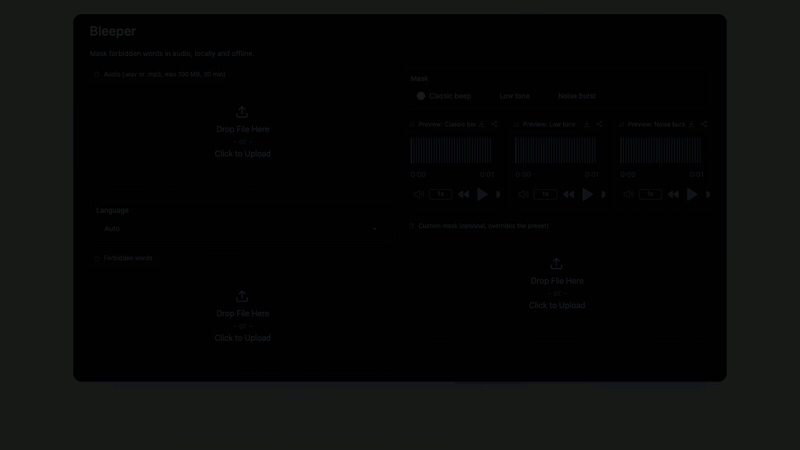
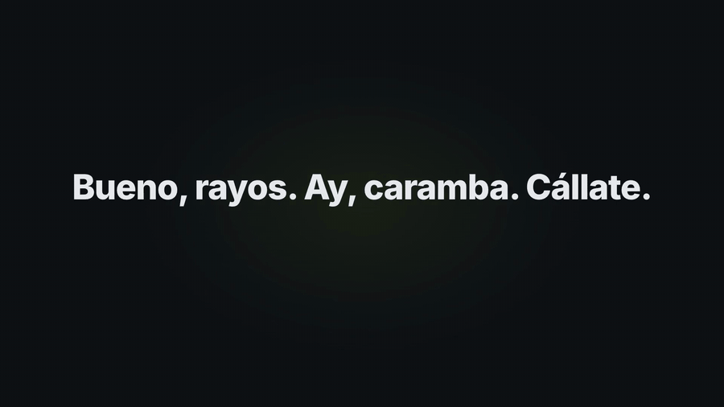
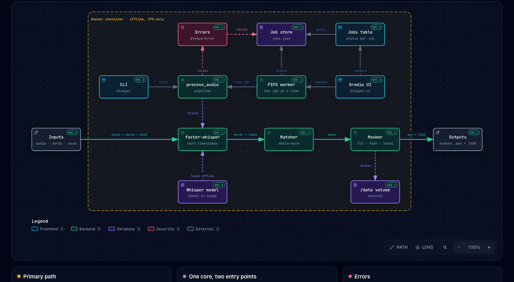
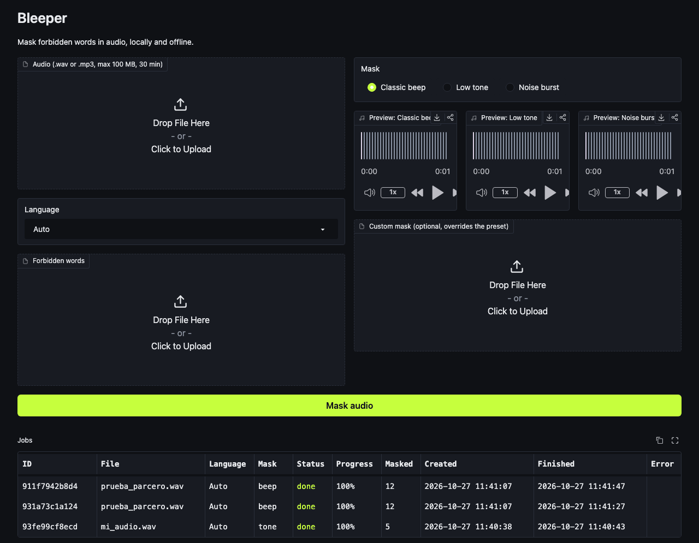

# Bleeper

Mask forbidden words in audio files. Bleeper transcribes a recording locally with
[faster-whisper](https://github.com/SYSTRAN/faster-whisper) (CPU only), finds the words and phrases
you list, and replaces each one with a beep, a tone, noise or your own sound. Everything else in
the recording stays bit-for-bit identical.



| English | Español |
|---------|---------|
|  |  |

Full videos with sound: [`brag.mp4`](brag-output/brag.mp4) · [`brag-es.mp4`](brag-output/brag-es.mp4).



## Install

Requires Python ≥ 3.10 and [`ffmpeg`](https://ffmpeg.org/) on `PATH` (used for mp3 input and for
resampling custom masks).

```bash
brew install ffmpeg            # or your platform's package manager
uv venv && source .venv/bin/activate
uv pip install -e .            # add ".[dev]" for pytest, ruff and Gradio
```

The Whisper model (default `small`, ~500 MB) is downloaded once, on the first run.

## Usage

```bash
bleeper INPUT --words FILE (--mask FILE | --preset {beep,tone,noise}) -o OUTPUT
        [--model NAME] [--lang CODE] [--padding MS] [--report FILE]
```

```bash
bleeper episode.mp3 --words words.txt --preset beep -o out/episode-clean.wav
```

```text
Masked 3 spans.
Output: out/episode-clean.wav
Report: out/episode-clean.json
```

| Option | Default | Description |
|--------|---------|-------------|
| `INPUT` | — | Input audio, `.wav` or `.mp3`. Never modified. |
| `--words FILE` | — | Forbidden words file (see below). |
| `--mask FILE` | — | Custom mask sound, looped or trimmed to each span. |
| `--preset NAME` | — | Built-in mask: `beep` (1 kHz), `tone` (400 Hz), `noise` (white noise). |
| `-o, --output FILE` | — | Output WAV. Replaced if it exists; must differ from `INPUT`. |
| `--model NAME` | `small` | faster-whisper model name or local model path. |
| `--lang CODE` | auto-detect | Spoken language, e.g. `en`, `es`. |
| `--padding MS` | `80` | Milliseconds added before and after each match. |
| `--report FILE` | `OUTPUT` with `.json` | JSON report path. |

Exactly one of `--mask` / `--preset` is required. Run `bleeper --help` for the full help.

### Words file

UTF-8 text, one word or phrase per line. Blank lines and lines starting with `#` are ignored.

```text
# words to bleep
darn
heck
shut up
```

Matching ignores case, accents and punctuation (`Señor` matches `senor,`), and only whole words
count (`ass` never matches `class`). Phrases match consecutive words.

### Output

- A WAV with the input's sample rate, channel count and exact duration. mp3 input is written as
  16-bit WAV.
- Each match is padded, clamped to the recording, and merged with overlapping or touching
  neighbours. The mask is level-matched to the surrounding audio (500 ms on each side) and gets
  10 ms fades in and out.
- A JSON report with one entry per masked span (times in seconds):

  ```json
  [
    { "word": "darn", "start": 1.92, "end": 2.58 },
    { "word": "heck heck", "start": 4.1, "end": 5.03 }
  ]
  ```

### Exit codes

| Code | Meaning |
|------|---------|
| `0` | Success, including "no forbidden words found" |
| `1` | Invalid input: missing or bad files or options, output equal to input, ffmpeg missing |
| `2` | Processing error: model load, transcription, ffmpeg or write failure |

Errors are printed as one `error: ...` line on stderr saying what failed and how to fix it.

## Run with Docker

No Python, ffmpeg or model download needed: the image bundles everything (CPU only, about 1.7 GB)
and runs fully offline.

### Build

```bash
docker compose build
docker compose build --build-arg WHISPER_MODEL=base   # bake a different Whisper model
```

The model is baked into the image, so switching models needs a rebuild.

### Prepare data

```bash
mkdir -p data
cp my-recording.wav data/input.wav
printf 'heck\n' > data/words.txt
```

Inside the container these live under `/data`, so pass paths as `/data/...`.

### CLI

```bash
docker compose run --rm cli /data/input.wav --words /data/words.txt --preset beep -o /data/output.wav
```

This writes `data/output.wav` and `data/output.json`. Add `--network none` to prove it works
offline (`docker run --rm --network none -v "$PWD/data:/data" bleeper:local ...`). Exit codes match
the native CLI.

### Linux file ownership

Files are written as UID/GID 1000 by default. To own them yourself, prefix the command with
`BLEEPER_UID=$(id -u) BLEEPER_GID=$(id -g)` or put both in a `.env` file. (`UID` itself can't be
used: it is a read-only variable in bash.)

### Web UI

```bash
docker compose up -d ui      # then open http://localhost:7860
docker compose logs -f ui
docker compose down          # keeps your jobs
docker compose down -v       # also deletes them
```

The UI is reachable only from this machine (`127.0.0.1`). Change the host port with
`BLEEPER_UI_HOST_PORT=8080 docker compose up -d ui`.

| Variable | Container default | Native default | Meaning |
|---|---|---|---|
| `BLEEPER_MODEL` | the build-time model (`small`) | `small` | default Whisper model |
| `BLEEPER_UI_HOST` | `0.0.0.0` | `127.0.0.1` | address the UI listens on |
| `BLEEPER_UI_PORT` | `7860` | `7860` | port the UI listens on |
| `BLEEPER_UI_MAX_UPLOAD_MB` | `100` | `100` | upload size limit |
| `BLEEPER_UI_DATA` | `/var/lib/bleeper` | `~/.bleeper/ui` | where jobs are stored |

### Verify your setup

```bash
scripts/smoke.sh
```

It builds the image, generates a spoken sentence, masks one word with `--network none`, and checks
the output keeps its length, sample rate and channels, and changes only inside the reported span.

## Try it with the samples

The `samples/` folder holds example inputs. Unlike other audio, they are versioned
(see `.gitignore`); results go to `out/`, which is ignored.

| File | Content |
|------|---------|
| `samples/groserias_colombianas.txt` | Common Colombian Spanish profanity, including plurals and the ways Whisper tends to mistranscribe them (`gami`, `mal parido`, `gonorra`) |
| `samples/mi_audio.wav` | Short Spanish recording (~15 s) |
| `samples/prueba_parcero.wav` | Longer Spanish recording (~70 s) with many words from the list |

```bash
mkdir -p out
bleeper samples/prueba_parcero.wav --words samples/groserias_colombianas.txt \
  --preset beep -o out/prueba_parcero_limpio.wav --lang es --model large-v3
afplay out/prueba_parcero_limpio.wav     # macOS; any audio player works
cat out/prueba_parcero_limpio.json
```

To record your own sample on macOS, list the input devices and record from the microphone
(the device index varies per machine):

```bash
ffmpeg -f avfoundation -list_devices true -i ""          # find the microphone, e.g. [1]
ffmpeg -f avfoundation -i ":1" -t 60 -ac 1 -ar 44100 samples/my_recording.wav
```

Tips for slang and profanity:

- Bleeper masks only what Whisper writes, and it never prints the transcript. If a word is
  missed, add the likely mistranscriptions and splits to the list (e.g. `monorrea` for
  "gonorrea", or the phrase `hijo de puta` when "hijueputa" is split into words).
- `--model large-v3` recognizes colloquial Spanish much better than the default `small`, at
  roughly real-time speed on CPU.
- Some entries also have innocent meanings (`chimba` = "great", `sapo` = "frog") and are
  masked in every context.

## Web UI

A local browser UI runs the same masking as background jobs, so you can queue several files and
keep using the page while they process.



```bash
uv pip install -e ".[ui]"      # adds Gradio
bleeper-ui                     # or: python -m bleeper.ui
```

```text
Bleeper UI running at http://127.0.0.1:7860
```

| Option | Default | Description |
|--------|---------|-------------|
| `--port PORT` | `7860` | Local port to listen on. |
| `--data-dir DIR` | `$BLEEPER_UI_DATA` or `~/.bleeper/ui` | Where the jobs list and job files are kept. |

- Upload an audio file (`.wav` or `.mp3`, up to 100 MB and 30 minutes), a words file, a language
  and a mask (a preset you can preview, or your own sound), then press **Mask audio**.
- Jobs run one at a time, oldest first. The table refreshes every 2 seconds; select a row to play
  the result and download the WAV and the JSON report. Finished jobs can be deleted.
- The output is identical to the CLI's with the `small` model and 80 ms padding.
- The jobs list survives page refreshes and restarts. Jobs that were still queued or running when
  the UI stopped are marked as failed ("Interrupted"); submit them again.
- The server listens on `127.0.0.1` only, with no share link, analytics or web fonts.

Data directory layout:

```text
~/.bleeper/ui/
├── jobs.json                  # the jobs list
├── tmp/                       # Gradio's upload cache, emptied at start-up and hourly
└── jobs/<job id>/
    ├── <name>_masked.wav      # result
    └── <name>_masked.json     # report
```

Uploaded inputs are copied into the job's folder and deleted as soon as the job finishes.

The native UI reads the same `BLEEPER_MODEL`, `BLEEPER_UI_HOST` (default `127.0.0.1`),
`BLEEPER_UI_PORT` (default `7860`) and `BLEEPER_UI_MAX_UPLOAD_MB` (default `100`) variables.

## Privacy and offline use

- Transcription runs on your CPU. After the model is cached, Bleeper makes no network calls.
- Audio and transcripts are never logged or uploaded; only counts and paths are printed.
- Temporary files are removed whether the run succeeds or fails, and a failed run leaves no
  partial output.

## Python API

```python
from bleeper.core import process_audio


def on_progress(stage: str, fraction: float) -> None:
    print(f"{stage}: {fraction:.0%}")


result = process_audio(
    "episode.wav",
    "words.txt",
    "episode-clean.wav",
    preset="beep",  # or mask_path="quack.wav"
    language="en",
    progress=on_progress,  # stages: loading, transcribing, masking, writing, done
)
for entry in result.report:
    print(entry.word, entry.start, entry.end)
```

Errors are raised as `InvalidInputError` or `ProcessingError` (both subclass `BleeperError`).
The CLI and the API produce byte-identical output for the same inputs.

## Development

```bash
ruff format --check . && ruff check .
pytest                  # offline, no model needed
pytest -m whisper       # optional: real-model tests (need a cached model, macOS `say`, ffmpeg)
```

## Known limitations

- Digits and spelled-out numbers are not equivalent: `5` does not match `five`.
- Matching depends on Whisper's transcript; misheard words are not masked.
